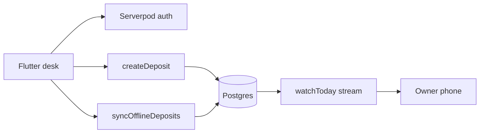

<p align="center">
  <a href="https://tallyaccra.serverpod.space/">
    <strong>TALLY</strong> — Accra Guest-House Till
  </a>
</p>

<p align="center">
  <a href="https://tallyaccra.serverpod.space/"></a>
  <a href="https://github.com/henrysammarfo/tally-accra"></a>
  <a href="https://builderbase.com/event/build-something-real-the-serverpod-hackathon"></a>
</p>

<p align="center">
  
  
  
  
</p>

---

## Project description and overview

**TALLY** is a guest-house till for Accra.

Night staff take a deposit, lock a room for the night, and see today’s total in Ghana Cedis. That is the whole job. No inventory. No mega POS. Just the desk flow that has to work when the internet is flaky.

> Soft pitch: TALLY takes the deposit, locks the night, and shows today’s tally — even when the desk briefly goes offline.

We never invent deposits. We never invent AI room scores. Missing keys fail closed and stay labeled. We do not claim the system is unhackable.

**Live till:** https://tallyaccra.serverpod.space/  
**API:** https://tallyaccra.api.serverpod.space/  
**Video scripts:** [`docs/VIDEO_SCRIPTS.md`](docs/VIDEO_SCRIPTS.md)  
**BuilderBase paste:** [`docs/memory/PROJECT_DESCRIPTION.md`](docs/memory/PROJECT_DESCRIPTION.md)

---

## Two tracks we ship

| Track | What is live | Where |
| :--- | :--- | :--- |
| **A — Hackathon submission** | Flutter desk + Serverpod 4: deposit → lock night → today’s tally, offline sync, live `watchToday` | [`tally/`](tally/) · live Cloud URL |
| **B — Marketing** | Brand and pitch only — **not** the live till | [`src/`](src/) |

Doctrine on both tracks: fail closed, no mock till, no localStorage ledger, no fake Serverpod claims.



---

## Demo path (judges)

1. Open https://tallyaccra.serverpod.space/
2. Sign in → bootstrap guest-house
3. Take a deposit → lock a room night
4. See today’s tally
5. Toggle offline → queue a deposit → go online → **Sync** → tally updates

---

## Stack

- **Flutter** desk (web + mobile targets)
- **Serverpod 4** + generated Dart client
- **Serverpod Cloud** project `tallyaccra` (Starter)
- **Postgres** for orgs, rooms, deposits, audit
- Optional **Jev** room/shift tips — fail closed without a key

---

## Commands

```bash
# Marketing (optional)
npm i && npm run dev

# Serverpod spine
cd tally/tally_server && dart test
cd ../tally_flutter && flutter analyze
cd .. && serverpod start
```

Deploy notes: [`tally/DEPLOY.md`](tally/DEPLOY.md)

---

## Honesty / residual risk

No localStorage till. Anonymous writes rejected. Jev and desk AI fail closed when keys are missing.  
See [`docs/memory/SECRETS_POLICY.md`](docs/memory/SECRETS_POLICY.md) and [`docs/memory/WIN_CHECKLIST.md`](docs/memory/WIN_CHECKLIST.md).

Not financial advice. Built for the Serverpod “Build Something Real” hackathon.

## Docs

- [`docs/memory/PROJECT_DESCRIPTION.md`](docs/memory/PROJECT_DESCRIPTION.md) — BuilderBase field paste  
- [`docs/VIDEO_SCRIPTS.md`](docs/VIDEO_SCRIPTS.md) — demo voiceover  
- [`docs/memory/BUILDERBASE_SUBMIT.md`](docs/memory/BUILDERBASE_SUBMIT.md) — full submit pack  
- [`docs/memory/TALLY_BIBLE.md`](docs/memory/TALLY_BIBLE.md) — product doctrine  
